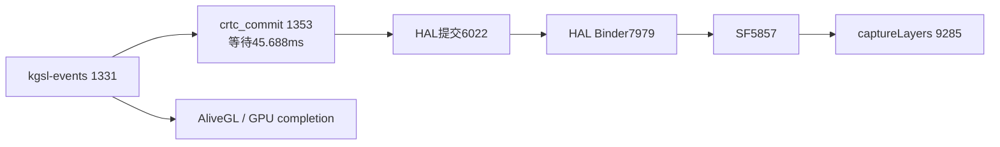

# 0.4.35 音乐入睡轨迹复核（2026-10-15）

本轮是遮挡优化未生效的对照。LSPosed 日志报告 `ColorOS immersive backdrop observation unavailable: NoSuchMethodError KeyguardStateControllerImpl#isVisible`：方法定义在接口 default 中，`XposedHelpers.callMethod` 未找到它。主任务已改为 `Class.getMethod("isVisible").invoke(...)`，后续必须重新采集才能验证暂停渲染的效果。本轮壁纸始终继续提交，不能用来评价优化后是否仍卡。

原始材料为 `build/music-aod-20261015/035.perfetto-trace`（134,304,789 bytes）、`035-reproduction-logcat.txt` 与 `perfetto-next.pbtxt`。轨迹实际保留 `ts=17205568550998..17232542951351`，约本地时间 **14:04:16.298–14:04:43.573**；45 s/128 MB 环缓冲已覆盖开头，部分进程名元数据也已丢失。日志后续 14:04:50–56 的按键不在轨迹内。已知 PID：SystemUI 22537，壁纸 29722，SF 5857，显示 HAL 5596，模糊服务 8866。

## 四次入睡窗口

均从 `goToSleep` 起统计后 832 ms；耗时为 wall time，可能包含等待。

| 入睡时间 | 壁纸 eglSwap 次数 | 最长 eglSwap | 最长 DRM commit | 最长 SF HWC 等待 | 私有官方时钟绘制录制 |
| --- | ---: | ---: | ---: | ---: | ---: |
| 14:04:22.608 | 80 | 49.078 ms | 40.193 ms | 35.451 ms | 1 次 / 0.026 ms |
| 14:04:25.380 | 80 | 58.125 ms | 57.002 ms | 51.825 ms | 1 次 / 0.041 ms |
| 14:04:29.354 | 84 | 56.195 ms | 40.090 ms | 40.108 ms | 1 次 / 0.049 ms |
| 14:04:31.320 | 82 | 63.580 ms | 48.552 ms | 48.776 ms | 1 次 / 0.046 ms |

壁纸 AliveGL tid=29873 在可见的稳定区间约每秒提交 100–121 次。四次入睡仍出现相同类型的显示提交等待，但本轮不是旧轨迹的 75 ms 数值。SystemUI 主线程各窗口 `Record View#draw()` 最大 0.837–1.045 ms；`measure/layout` 各次最大都小于 1.75 ms。第三次虽有 32 次 measure、30 次 layout，其总耗时分别仅 10.213/4.223 ms，不能据次数认定时钟 Java 布局是阻塞原因。

## 第四次的 GPU 与显示等待链

关键片段在 `ts=17220641778440..17220710602763`，约 14:04:31.372–31.441。

| Slice ID / 时间 | 观测 | 耗时 |
| --- | --- | ---: |
| 677323 / 17220641778440 | 壁纸 GPU completion 2071 | 65.370 ms |
| 677637 / 17220644490628 | 壁纸 `eglSwapBuffers` | 63.580 ms |
| 678899 / 17220660285576 | HAL tid6022 `DRMAtomicReq::Commit::` | 48.552 ms |
| 678945 → 678949 | 模糊 Capture tid9164 → SF binder tid9285 | 51.267 ms |
| 678951 / 17220660682451 | 上述 Binder 内 `captureLayers` | 49.920 ms |
| 679028 → 679029 | SF tid5857 → HAL binder tid7979 | 48.711 ms |
| 682309 / 17220710421097 | 上述截图实际进入 `captureScreenshot` | 0.172 ms |

与旧轨迹相比，本轮从调度与 KGSL 功耗事件得到更具体的证据：

- `kgsl_pwrstats` 在 8 个相邻样本中报告 total=64,663 μs、busy=64,506 μs，即 **99.76% busy**。样本结束时刻范围 `17220649495003..17220705742190`，采样覆盖约 64.7 ms，和等待重合。GPU 频率从 389 MHz 依次升到 443、525、607、660、734、832、900 MHz；这属于总 GPU 状态，没有进程归属。
- 内核 `crtc_commit:210` tid1353 从 `17220661399951` 睡眠 **45.688 ms**，到 `17220707087503` 被 `kgsl-events` tid1331 唤醒。
- 同一 `kgsl-events` 随后在 `17220707102190/17220707115107` 唤醒壁纸 AliveGL/GPU completion。
- crtc tid1353 在 `17220708737972` 唤醒 HAL 提交 tid6022；6022 在 `17220708950315` 唤醒 HAL binder7979；7979 在 `17220709953909` 唤醒 SF5857；SF 在 `17220710382451` 唤醒截图 binder9285。

这支持 GPU 完成等待沿显示提交链传播，已不只是“某个 DRM 调用较长”的相关性。截图在 DRM 调用开始约 0.397 ms 后进入，线程在其中睡眠 49.686 ms，实际截图录制仅 0.172 ms；仍不能把 `captureLayers` 的 wall time 全部计为截图算法耗时，也不能认定它触发了此次等待。

缺少逐提交 context/fence ID，仍无法把 busy 分别归给壁纸、原生音乐内容、SystemUI 模糊或其他客户端；不能把壁纸 GPU completion 的 65.370 ms 当作壁纸 shader 独占执行时间。0.832 s 的平均 busy 约 48%，也不能用平均值抹掉前段约 65 ms 的高 busy。

## 采集限制与其他长等待

读取原始事件必须使用 `TraceProcessorConfig(ingest_ftrace_in_raw=True)`；Python API 默认不填充 `ftrace_event`。本轮实际事件只有 sched、Binder、CPU power、`kgsl_pwrstats/buslevel/pwrlevel` 和 atrace print，`gpu_slice=0`。

`metadata` 的 `ftrace_setup_errors` 记录了 19 项错误：7 个 `dma_fence/*` 为 failed，3 个 DRM vblank 与 9 个 KGSL/adreno 提交/退役事件为 unknown。虽然配置依据 available_events 选择了名称，生产者仍没有成功启用这些事件。后续采集先做短跑并检查该 metadata，再将其作为 GPU fence 采集；当前数据不能宣称已有完整 fence 记录。

约 14:04:33.636 有一段壁纸 `eglSwapBuffers=743.642 ms`、GPU completion=747.828 ms。它不在面板转场前 832 ms 内；末尾两个线程由 `HansBgHandler` tid8446 唤醒，日志同段壁纸广播 defer 在 14:04:33.640 设 true、14:04:34.380 设 false。此长等待与进程冻结相符，应单独调查，不能把它作为 748 ms GPU 执行或显示驱动挂死的证据。

## 可复核结果

- `035-initial.json`、`035-second.json`、`035-third.json`：时钟映射、线程、事件、设置错误与全局统计。
- `035-runs.json`：四次入睡的主线程、慢片段、绘制/截图次数与 FrameTimeline。
- `035-fourth-detail.json`：第四次关键 slice、Binder flow、sched 唤醒与 KGSL busy 原始值，包含 SQL。
- `035-gpu-kernel.json`：内核显示/GPU 线程调度、频率与 busy 汇总，包含 SQL。
- `035-gpu-context.json`：总 GPU busy 对照及 743 ms 等待的调度，包含 SQL。

时钟换算为 `REALTIME(ns)=ts+(1792044238233176896-17187503228453)`，本地时区 UTC+8。

下一轮首先确认 `Native music backdrop covered=true` 后壁纸提交归零，并验证退出/解锁能够恢复；再做相同条件的四次入睡对照。当前结论支持先移除被覆盖壁纸的 GPU 工作，但不足以证明该措施必然消除原生显示等待。

## 修正接口后的验收补记

`Class.getMethod("isVisible").invoke(...)` 修正已包含在最终 0.4.35 APK，设备与本地 SHA-256 均为 `d8b8fe30809ce9f05b70ef9950f49736689903edee5ce80453cf63d0ebdcaae8`。用户随后多次实测反馈「明显顺了」「顺滑了许多」，最终确认当前无问题；3D 灵敏度与 AOD 动效也已由用户验收。

修正后的 `035b.perfetto-trace` 和限时日志没有覆盖用户稍后进行的 14:14 复现。不能据此声称壁纸暂停门控已命中，或给出 GPU/显示提交耗时下降的量化结论。上述性能机制仍以源码门控、host 检查和用户实测改善为证；原始基线保留以供后续有需要时复查。

生产 `Diagnostics.TRACE=false`，不启用逐帧、陀螺仪或触摸调试输出。音乐背景仅在遮挡布尔状态改变时记一条状态日志，兼容失败每个阶段只报告一次。采集已结束，设备没有仍在运行的 Perfetto 采集进程。
